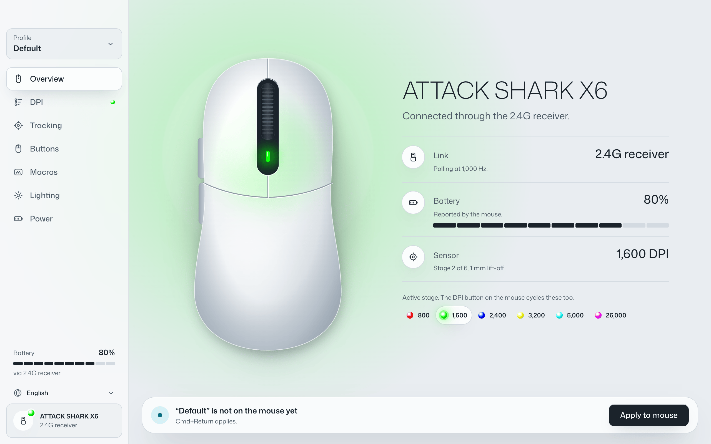
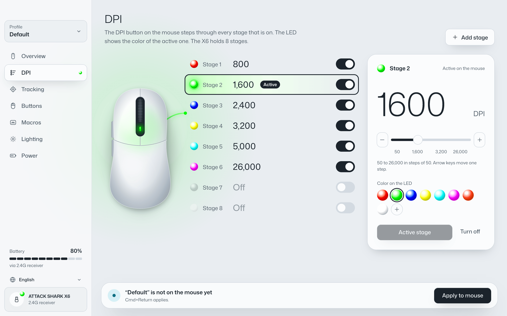
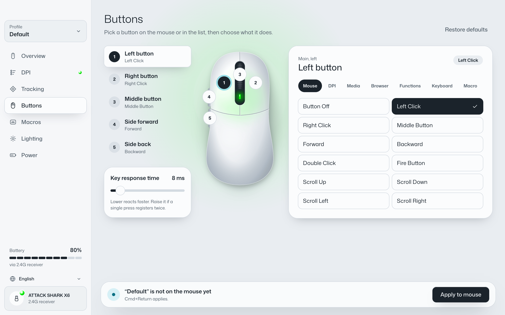
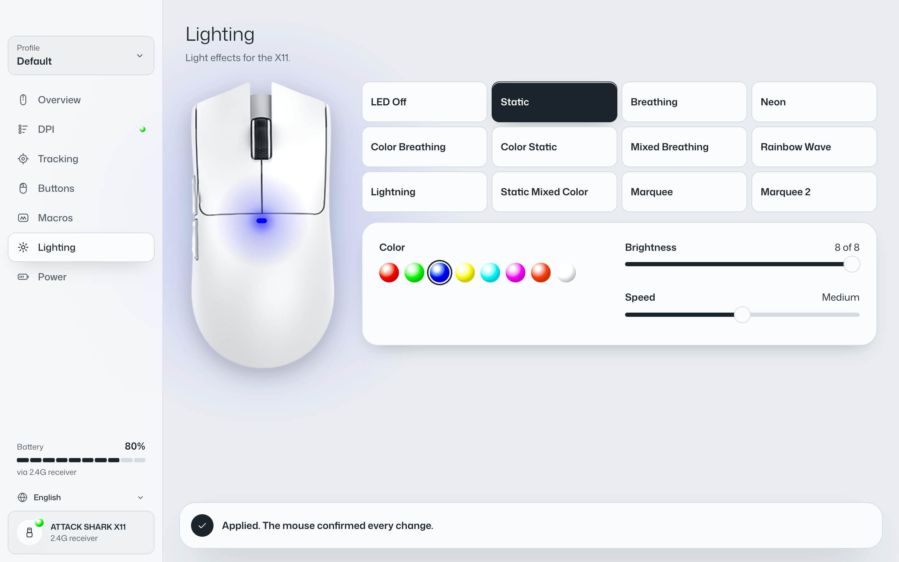
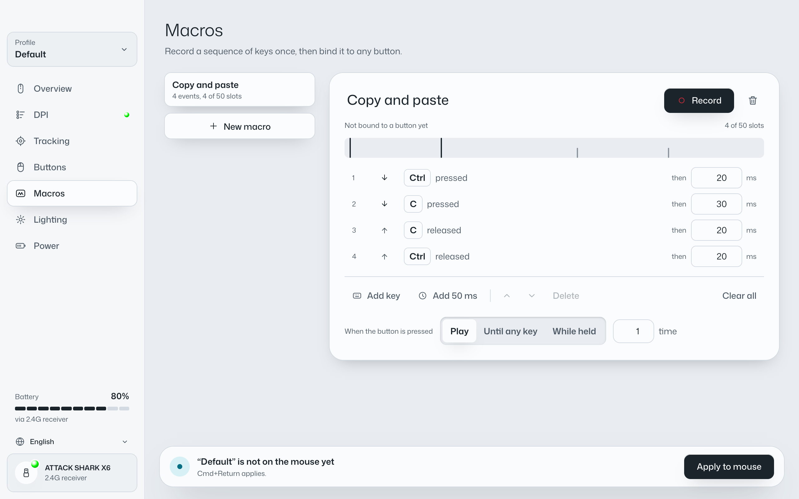

<p align="center">
  
</p>

<h1 align="center">ATTACK SHARK Configurator</h1>

<p align="center">An open-source configurator for ATTACK SHARK gaming mice on macOS, Linux and Windows.</p>

<p align="center">
  <a href="https://github.com/lucasbrito-wdt/attack-shark-configurator/releases/latest"></a>
  <a href="https://github.com/lucasbrito-wdt/attack-shark-configurator/releases"></a>
  <a href="LICENSE"></a>
  
  <a href="https://github.com/lucasbrito-wdt/attack-shark-configurator/actions/workflows/ci.yml"></a>
</p>

<p align="center">
  
</p>

Unofficial. This project is not affiliated with or endorsed by ATTACK SHARK (see [Disclaimer](#disclaimer)).

## Features

- DPI stages with a color per stage, polling rate, lift-off distance.
- Angle snap, ripple control and motion sync on the models that support them.
- Lighting modes and colors.
- Button remapping and macros. The button map uses the official driver's encoding. Buttons the app does not expose
  (the DPI keys and the wheel) keep their factory action.
- Battery level in the window and in the menu bar / system tray.
- Read-back of the mouse state and a DPI-encoding check.
- Closing the window keeps the app running in the tray.
- Automatic updates, verified against a signed manifest.
- Interface in Portuguese (Brazil), English and Spanish.
- Connects over USB cable, the 2.4G receiver or Bluetooth LE.

## Screenshots

| DPI | Buttons |
| --- | --- |
|  |  |
| **Lighting** | **Macros** |
|  |  |

## Supported models

Only the **X6** has been verified on real hardware by the maintainer (USB cable and Bluetooth LE). Every other model is
implemented from the vendor driver's model tables and protocol analysis and is marked **untested**: it is expected to
work, but nobody has confirmed it. If you own one, please [report the result](CONTRIBUTING.md#reporting-a-new-or-untested-model).

| Model | Family | Connections | Status |
| --- | --- | --- | --- |
| X6 | BK, family A | USB, 2.4G, BLE | Verified (USB, BLE) |
| X3 | BK, family A | USB, 2.4G, BLE | Untested |
| R1, X11, X3 MAX, X1 | BK, family B | USB, 2.4G, BLE | Untested |
| V5 SE, X11 SE, X8 SE, X8 Plus, G3, G3 PRO, V3 PRO, V6, V3 | BK, family B | USB, 2.4G, BLE | Untested |
| X11 PRO, X8 PRO | BK, family B | USB, 2.4G, 2.4G 4K receiver, BLE | Untested |
| X3 PRO | BK, family A | USB, 2.4G, 2.4G 4K receiver, BLE | Untested |
| F1, X11 PRO V2 | BK, family C1 | USB, 2.4G | Untested |
| R6, R5 Ultra | XVI | USB, 2.4G | Untested |
| X3 PRO, R2, R3 (Driver v4 firmware, several variants) | V4 | USB | Untested |

Notes:

- Support differs per model: lift-off distance, lighting, macros, battery over BLE and the available polling rates
  depend on what the model exposes. The UI only shows what the connected model supports.
- The DPI encoding of the X3/X6 and of several other models is still being confirmed. On those models the app first reads
  the DPI table back from the mouse (over the cable or receiver) and only writes DPI once the encoding checks out; the
  other settings apply normally. `SHARK_ALLOW_UNVERIFIED=1` skips the check (see
  [Environment variables](#environment-variables)).
- The authoritative list is in code: `crates/shark-core/src/platform/bk/registry.rs`, `platform/v4/registry.rs` and
  `platform/xvi/registry.rs`.

## Download and install

Get the installer for your system from the
[latest release](https://github.com/lucasbrito-wdt/attack-shark-configurator/releases/latest).

### macOS (11 or later)

1. Download the `.dmg` for your Mac (Apple Silicon or Intel) and drag the app to Applications.
2. The app is not notarized. On first launch macOS blocks it: open **System Settings > Privacy & Security** and click
   **Open Anyway**.
3. Grant **Input Monitoring** (needed for HID access) and **Bluetooth** (for BLE mode) when asked.

Because builds are ad-hoc signed, macOS may ask for these permissions again after an update.

### Linux

- **Debian / Ubuntu**: install the `.deb` (`sudo apt install ./attack-shark-configurator_*.deb`). It installs the udev rule
  and reloads udev. Replug the mouse or receiver afterwards.
- **Other distributions**: use the AppImage and install the udev rule by hand (see
  [Linux udev](#linux-udev)).

Auto-update works for the AppImage. `.deb` users update through the package.

### Windows

Download the `.msi` or the setup `.exe` and run it. Windows support is **new in 0.1.0 and has not been tested on real
hardware yet**. Please report what works and what does not.

### Updates

The app checks for updates and verifies them against the public key in `src-tauri/tauri.conf.json` before installing.

## Permissions and troubleshooting

### macOS permissions

If the mouse is not found or Bluetooth does not connect, check **System Settings > Privacy & Security** for
**Input Monitoring** and **Bluetooth**, make sure the app is enabled, then restart it.

### Linux udev

Without a udev rule the logged-in user cannot open the hidraw nodes. The `.deb` installs it. Otherwise:

```sh
sudo cp packaging/linux/99-attack-shark.rules /etc/udev/rules.d/
sudo udevadm control --reload-rules && sudo udevadm trigger
```

Then replug the mouse or receiver. The rule lists every cable and receiver the app knows (a test keeps it in sync with
the model table). If your mouse uses a PID that is not listed, add a line for it following the same pattern and send a
[model report](CONTRIBUTING.md#reporting-a-new-or-untested-model).

### Bluetooth

Over Bluetooth LE the mouse does not acknowledge writes, so the app cannot confirm a change landed and marks the profile
as **unconfirmed**. Apply settings over the USB cable or the 2.4G receiver when you can. Several models report a wrong
battery level over BLE, so the app shows none there.

### Mouse not detected, or "exclusive access" error

Another program may be holding the mouse. Close the vendor's own configurator and any other tool that talks to the
device (including a second copy of this app), then replug it. If it still fails, set `SHARK_LOG_RAW=1`, reproduce the
problem and attach the log to a [bug report](https://github.com/lucasbrito-wdt/attack-shark-configurator/issues/new/choose).

### Environment variables

- `SHARK_LOG_RAW=1`: log every raw report sent and received.
- `SHARK_LOG_EVENTS=1`: print every raw USB input report and BLE notification as hex to stderr.
- `SHARK_NO_BLE=1`: do not start the Bluetooth backend.
- `SHARK_ALLOW_UNVERIFIED=1`: allow writes whose encoding is not verified on hardware (DPI on the X3/X6, variant T DPI above
  10000, and any write over the 4K receiver or the X3 PRO cable). Use it at your own risk.

## Building from source

Requirements: Rust (stable), [Bun](https://bun.sh) and the Tauri CLI:

```sh
cargo install tauri-cli --version "^2" --locked
```

Linux also needs `libudev-dev`, `libdbus-1-dev`, `pkg-config` and the Tauri prerequisites (`libwebkit2gtk-4.1-dev`,
`libgtk-3-dev`, `libayatana-appindicator3-dev`, `librsvg2-dev`).

```sh
cd ui && bun install && cd ..
cargo tauri dev                               # Vite dev server + the app
cargo tauri build                             # bundles for the current OS
cargo test --workspace
cargo build -p shark-core --no-default-features  # USB only, without BLE
```

`scripts/install.sh` builds and installs for the current user on macOS and Linux (`.app` on macOS, `.deb` or AppImage on
Linux). `scripts/uninstall.sh` reverses it and keeps local settings.

### Hardware probe

Read-only; it never writes configuration. Plug the cable or receiver, then run:

```sh
cargo run -p shark-core --bin shark-probe -- --read
```

It lists the matching HID interfaces, asks the mouse for its state, and prints the firmware version and raw reply.
`--listen <seconds>` prints input reports and BLE notifications.

### Releases

The app updates from `releases/latest/download/latest.json` on GitHub. One-time setup: generate a signing key and store
it as a repository secret. Never commit the key.

```sh
cargo tauri signer generate -w ~/.tauri/attack-shark-x3.key
gh secret set TAURI_SIGNING_PRIVATE_KEY < ~/.tauri/attack-shark-x3.key
```

Cut a release:

```sh
scripts/release.sh 0.2.0   # bumps versions, runs cargo check, prints the git commands
# run the printed commit / tag / push commands
```

Pushing a `v*` tag runs `.github/workflows/release.yml`, which builds the bundles and creates a draft release with
`latest.json`. Publish the draft to roll the update out.

## Project layout

| Path | Contents |
| --- | --- |
| `crates/shark-core` | Protocol, device layer (USB HID and BLE), profile model, storage, per-model capabilities. No UI. |
| `src-tauri` | Tauri v2 shell: commands, events, state machine, tray. |
| `ui` | Vue 3 + Vite interface. `ui/src/api` has a typed client with a mock backend for browser-only design work. |
| `docs` | [PROTOCOL.md](docs/PROTOCOL.md), [protocol/](docs/protocol), [API.md](docs/API.md), [VENDOR_SOFTWARE.md](docs/VENDOR_SOFTWARE.md). |
| `packaging/linux` | udev rule and `.deb` post-install script. |
| `design` | Design tokens and the app icon source. |
| `scripts` | Install, uninstall and release helpers. |

## Contributing

Bug reports, model reports and pull requests are welcome. Read [CONTRIBUTING.md](CONTRIBUTING.md) first. Report
vulnerabilities as described in [SECURITY.md](SECURITY.md). This project follows the
[Code of Conduct](CODE_OF_CONDUCT.md).

## License

Released under the [GNU General Public License v3.0 only](LICENSE). You may use, study, modify and share it. If you
distribute a modified version, it must stay open under the same license, with its source available.

## Disclaimer

This project is not affiliated with, endorsed by, or sponsored by ATTACK SHARK or its manufacturer. "ATTACK SHARK" and the
model names are trademarks of their respective owners and are used only to identify compatible hardware. No vendor
software, images or logos are distributed in this repository. The protocol knowledge comes from observing USB and Bluetooth
traffic and from static analysis of the vendor's Windows driver, done for interoperability (see
[docs/PROTOCOL.md](docs/PROTOCOL.md) and [docs/VENDOR_SOFTWARE.md](docs/VENDOR_SOFTWARE.md)). Use it at your own risk:
writing wrong values to a device can misconfigure it.
